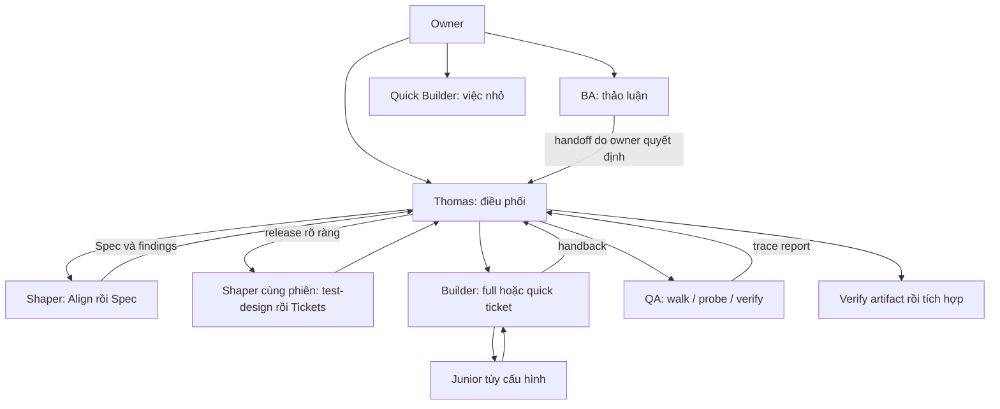

# Thiết kế Astragentic cho Codex

> Cập nhật sau góp ý owner: dùng harness gọn, native Herdr/Codex và record Markdown.
> Prototype engine đã gỡ; trạng thái hiện hành ở [IMPLEMENTATION-STATUS.md](IMPLEMENTATION-STATUS.md).
> Các chi tiết triển khai cũ bên dưới là lịch sử, không phải hướng dẫn runtime hiện hành.

Trạng thái: thiết kế đề xuất, chưa triển khai runtime. Baseline và dòng nguồn trong
[INVENTORY](INVENTORY.md). Mọi đường dẫn/lệnh mới bên dưới là đích dự kiến.

## Hành trình owner

Ba entrypoint độc lập dự kiến: `astra-codex thomas`, `astra-codex ba`,
`astra-codex quick-builder`. Đây là launcher Astragentic cần xây, không phải lệnh
Codex đã có. Launcher chọn project, role, model/effort, nạp contract rồi mở phiên.
Resume bằng session ID gắn với project/role; không suy diễn từ pane focus/--last.

## Role đầy đủ

Số đo: 7 role nghiệp vụ trong 10 file contract/supplement; nguồn `.agents/roles`.

| Role | Ai mở / context | Đầu ra và ranh giới |
|---|---|---|
| Thomas | Owner; resident; orchestrator, tracker, labels, reconcile, frontier | claim/dispatch, QA, verify/merge; khôi phục sau restart |
| BA | Owner; tracker, glossary, product docs, memory, astra-ux | handoff; chỉ tạo/sửa ticket khi owner duyệt cụ thể; không code/dispatch |
| Quick Builder | Owner; một việc không ticket; tool, project/upstream scope | worktree ops; before/after; chờ owner trước land; không dispatch |
| Shaper | Thomas; effort, PRD journeys, boundaries | Align→Spec→arm→dừng; release→test-design→Tickets; cùng phiên |
| Builder | Thomas; ticket/base/criteria/write-set/QA plan | full TDD/UI/review/simplify/arm; quick loop riêng; handback |
| QA | Thomas; mode/plan/target SHA/persona/consent | chạy sản phẩm, trace matrix; không sửa code để che finding |
| Junior | Builder; red tests/write-set/runtime adapter | green implementation; trailer; Builder vẫn sở hữu review |

`builder-claude`, `thomas-claude`, `junior-grok` là supplement, không là role mới.
`builder-quick` trong orchestrator phục vụ quick ticket, khác owner `quick-builder`.

## Nạp context và vị trí file

Root AGENTS chỉ định tuyến và invariant. Launcher nạp một contract; skill nạp khi
đến pha; RULES đọc trước, evidence memory tra theo ID. Resume/compact phải khôi
phục role, brief và checkpoint. Cơ chế injection cụ thể: chưa đo.

| Đích downstream | Nạp bằng gì |
|---|---|
| AGENTS.md | Native instructions; merge có quản lý vào file owner |
| .agents/orchestrator-for-codex.md | Launcher/dispatcher đọc rõ; đầy đủ role, model/effort, capacity, junior, arm |
| .codex/roles/*.md | Launcher đọc; không tự discovery |
| .agents/skills/<name>/SKILL.md | Native skills; giữ tên astra-* khi có thể |
| .agents/skills/<name>/agents/openai.yaml | Invocation policy nếu cần; không giả định frontmatter Claude tương đương |
| .codex/agents/*.toml | Helper subagents; không dùng thay phiên BA/Thomas |
| .codex/hooks.json | Hooks riêng, trust theo runtime |
| scripts/codex/* | Launcher, dispatch, evidence, status, verifier, cleanup |

Số đo: 2 vòng equality trong install.sh:50–124. Đề xuất source overlay riêng
`runtimes/codex/` ngoài payload auto-apply hiện tại. Installer chọn manifest runtime;
`.agents/skills` nhận bản Codex, `.claude/skills` giữ bản Claude. Equality chỉ áp dụng
phần shared; phần diverge phải có manifest cụ thể, không xóa toàn bộ check.

Phải thử coexistence: Claude vẫn load đúng skill Claude khi `.agents` có bản Codex.
Nếu discovery trùng tên, giải quyết packaging/namespace trước release, không đoán
precedence. Doctor, drift check, staging, adoption, uninstall cùng đọc manifest.
Owner config viết khi chưa có, upgrade giữ lựa chọn; không tự bật trust/model/arm.

## Mapping 17 skill

Nguồn mỗi dòng: `harness/.agents/skills/<name>/SKILL.md`; line pointers trong INVENTORY.

| Skill | Hướng chuyển đổi |
|---|---|
| astra-ux | Giữ journeys/actors; hỏi bằng tool có thật, không quyết thay owner |
| astra-grill-with-docs | Giữ frontier/citations; đổi invocation và route câu hỏi qua Thomas |
| astra-to-spec | Giữ seams/synthesis/needs-triage; adapter tracker và checkpoint |
| astra-to-tickets | Giữ slices/dependencies/quick-full; xác thực release Spec trước publish |
| astra-implement-with-tdd | Giữ red-green/criteria; đổi slash-first; thu test exit thật |
| astra-ui | Đổi Skill/Agent plugin call sang skill và ui-lens Codex; giữ rendered evidence |
| astra-review | Giữ correctness/intent/standards và triage; native review/context riêng; failed lens không clean |
| test-design | Giữ phương pháp; kiểm tra helper/path và trace QA |
| dispatch-ticket | Adapter Codex cho identity/launch/brief/state/handback/cleanup |
| dispatch-ticket-claude | Không expose làm launcher Codex; thay bằng dispatch-ticket-codex |
| dispatch-qa-walk | Giữ mode/plan/target; đổi launch/notification/report |
| dispatch-junior | Giữ ownership/trailer; dùng runtime row; không tự bật junior |
| codex-arm | Hiện là Claude→Codex; Codex root cần cross-vendor adapter hoặc explicit off |
| github-issue-tracker | Giữ tracker model/dependencies; probe CLI/plugin/claim/counts |
| jira-issue-tracker | Giữ transitions/relations; probe connector; bỏ phụ thuộc status-band mod |
| linear-issue-tracker | Giữ state/claim semantics; probe connector có thật |
| reconcile-tracker | Giữ read-only git-vs-tracker; không tự sửa drift |

Thêm simplify Codex: giữ hành vi, sửa có căn cứ, rerun test, evidence đúng tree;
không giả receipt Skill(simplify). 3 helper plugin hiện tại: astra-slice-reviewer,
astra-test-architect, astra-ui-lens chuyển TOML khi phù hợp. Intent/standards reviewers
cần context riêng, trả parent. Read-only prose không phải sandbox độc lập.

2 adoption skill batch-triage và bootstrap-glossary cũng trong phạm vi: đổi invocation,
kiểm tra write authorization. Không bỏ sót vì nằm ngoài harness.

## Dispatch và phục hồi

Số đo: mod register.tsx có session.start, prompt.compose, session.receive, skill.prompt,
turn.complete. Không copy mod đó thành hooks Codex. Callback end-to-end: chưa đo.

Role dispatched chạy process Codex riêng trong pane Herdr. Dùng Herdr làm đường
launch/prompt/status/read/wait chính, không xây transport Codex queue/app-server
song song nếu không có thiếu hụt đã đo. CLI Herdr 0.9.5 đã xác nhận có:
`agent start --kind codex --pane ID`, `agent prompt`, `agent wait`, `agent get/read`.
Dùng ID trả về từ đúng workspace/project. Shell launch thành công chưa chứng minh
brief được xử lý; đọc trạng thái và handback qua Herdr.

`working`, `blocked`, `idle`/`done` là trạng thái runtime, không là verdict ticket.
`done` và `idle` khác nhau về trạng thái đã xem kết quả. Sau prompt phải tránh coi
idle có sẵn trước dispatch là hoàn tất; đối chiếu transition và output mới. Chỉ
verifier artifact mới quyết định ticket xong. Không tái tạo bộ dò trạng thái Herdr.

Help trong skill Herdr có `herdr wait agent-status`, nhưng binary 0.9.5 hiện dùng
`herdr agent wait`; implementation phải theo help binary, không copy cú pháp cũ.

State: claimed → launching → received → working → waiting-input hoặc handback-ready
→ verified → integrated → cleaned. failed/interrupted là nhánh riêng. Turn kết thúc
chỉ là event, không tự thành completed.

Record: project/dispatch ID, attempt, role, ticket/kind, parent/child session,
pane/tab, worktree/branch, base SHA, brief hash, phase, timestamps, artifacts, sequence.
Update atomic có lock/CAS; replay idempotent; callback attempt cũ không đóng attempt mới.
Thomas có inbox bền vững, notification retry/ack. Restart reconcile session/process/Git
trước relaunch; không đoán worker chết từ im lặng. Shaper giữ session qua pause Spec.

State runtime tách namespace; quyền nhận ticket phải phối hợp nếu hai Thomas cùng
project. Chưa có claim chung đáng tin thì không hỗ trợ hai Thomas cùng frontier.
Tracker labels không tự bảo đảm atomic claim.

## Nền dispatch tham khảo khi thiết kế

Đối chiếu lại source: `dispatch-ticket-claude/SKILL.md:239,294` đã dùng
`herdr agent start --kind claude`. Đây là CLI Herdr, không phải lệnh mới của adapter.

Có hai đường lắng nghe hiện hữu:

- Pane Claude có mod: SendMessage → mod chạy brief → RECEIVED → TURN-END;
  record làm đường dự phòng. Không arm watcher thứ hai cho pane này.
- Pane không có mod: herdr agent prompt → scripts/herdr-watch-terminal.sh →
  TERMINAL/NO_START/TIMEOUT. WATCHING.md:30 mô tả contract; script chờ working
  trước, debounce và lấy verdict từ agent get mới sau mỗi wait slice.

Codex tham khảo logic đường không-mod đã tồn tại, nhưng phải có contract vận hành
riêng. Không dẫn role/agent/skill Codex sang markdown dispatch Claude để thực hiện.
Script chỉ được chia sẻ sau khi xác nhận độc lập runtime và có tests; không mặc
định phải tái sử dụng nguyên script hay dùng bare agent wait.
Workspace watchdog cũng đã tồn tại. Phải kiểm tra adapter orchestrator path và
logic nhận diện self-reporting pane trước tái sử dụng: session_id trong record
không được tự đồng nghĩa với có Claude mod. Giữ nguyên bản Claude khi điều chỉnh.

Chưa đo: completion của watcher shell được đưa trở lại Thomas Codex đang idle
thế nào. Đây là khoảng trống wake-up cụ thể cần probe; khác với khả năng Herdr
quan sát trạng thái, vốn đã có. Không suy từ sự tồn tại watcher sang end-to-end PASS.

## Gates và parity

Giữ pre-dispatch claim/base/worktree/QA plan; commit red/test evidence khi owed;
merge review/QA/arm/HEAD; cleanup resources. Enforcement nằm ở launcher/verifier
và hook hỗ trợ, không chỉ prompt. Hook không là ranh giới bảo mật toàn diện.

Receipt ghi runtime/producer/base/head/tree/command/result/timestamp. Không nhận
self-report đã gọi skill thay output. Code đổi sau review phải xét coverage lại.
Quick ticket và Quick Builder có gate khác nhau. BA/Quick Builder giữ owner approvals;
QA giữ consent. Cross-vendor off phải explicit; Codex→Codex không được gọi cross-vendor.

Advisor/status band/dispatch-board có thể thay bằng reviewer cấu hình/status CLI;
không tự bật paid reviewer. Đây là thay đổi trải nghiệm, không bỏ trách nhiệm role.

## Thứ tự triển khai

1. Probe context/discovery/transport theo VALIDATION trước chọn API launcher.
2. Runtime overlay, orchestrator, ba owner entrypoint; kiểm tra đúng context.
3. Port đủ role/skill theo bảng; kiểm tra reachability và checkpoint owner.
4. Shaper nhiều pha + Builder dispatch, callback/restart/failure.
5. QA, junior, review/simplify/arm, gates, hai loại quick.
6. Upgrade/uninstall/coexistence/full journey trước release.

## Nguồn Codex

- [Skills](https://learn.chatgpt.com/docs/build-skills): discovery .agents/skills, policy, trùng tên không merge.
- [Subagents](https://learn.chatgpt.com/docs/agent-configuration/subagents): TOML helpers; sandbox/approval trong agent file không override parent.
- [Hooks](https://learn.chatgpt.com/docs/hooks): coverage/limits; transcript không là API ổn định.
- [Commands](https://learn.chatgpt.com/docs/developer-commands?surface=cli): review/queue/resume/debug prompt-input; cần probe CLI đang cài.

Docs xác nhận cơ chế; không xác nhận integration Astragentic đã hoạt động.

## Ranh giới tài liệu và giao tiếp giữa các phiên

Markdown Claude chỉ làm nguồn khảo sát của builder harness. Role, agent và skill
Codex phải tự đủ hoặc tham chiếu contract Codex; không có chỉ dẫn vận hành yêu cầu
đọc contract Claude. Các trích nguồn ở DESIGN/INVENTORY là bằng chứng thiết kế,
không phải context load của các role runtime.

Hai đường giao tiếp đã xác nhận tồn tại qua CLI/help, chưa đo end-to-end:

1. Herdr `agent prompt <pane-id> <text>`: gửi từ phiên này vào phiên khác trong
   workspace qua pane cụ thể. Là đường mặc định cần thử trước.
2. Codex `queue --thread <session-uuid> --message <text> --resume`: hàng đợi native
   cho phiên có sẵn, cần daemon/server khi resume. Có thể thử thay transport gửi
   nếu xử lý idle/busy tốt hơn; Herdr vẫn quản lý pane và trạng thái.

Không gửi đồng thời cả hai đường cho một event vì có thể tạo hai lượt xử lý.
Kết quả hoàn thành lưu file; message mang dispatch ID, attempt, event ID và đường
file. Thomas xác nhận event, đọc artifact; blocked/question cũng theo cùng đường.
Agent con trong một session và peer Codex ở hai tab là hai topology khác nhau.
Chưa coi công cụ gửi cho subagent là cách gửi được tới mọi session độc lập.

## Quyết định owner cập nhật

Owner ưu tiên thử codex queue cho giao tiếp liên phiên. Herdr giữ launch/pane/status;
queue thử trước cho brief/follow-up/handback. Điều này thay thế lựa chọn Herdr prompt
mặc định trong các đoạn khảo sát trước. Phạm vi đề xuất hiện hành và các điều kiện
fallback nằm ở OWNER-REVIEW.md. Chờ owner góp ý báo cáo trước mở rộng implementation.
